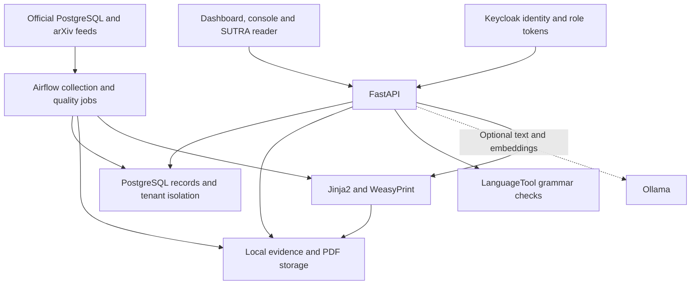
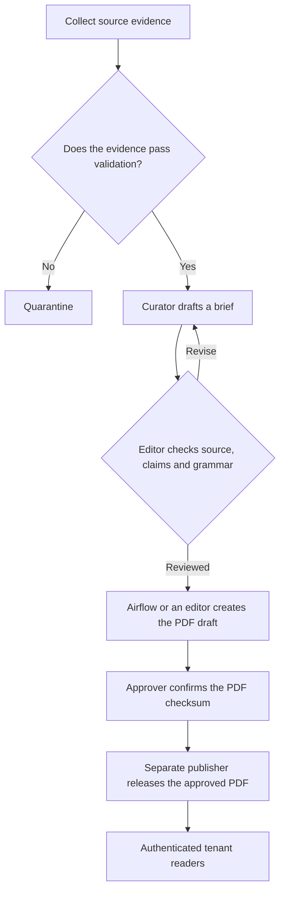
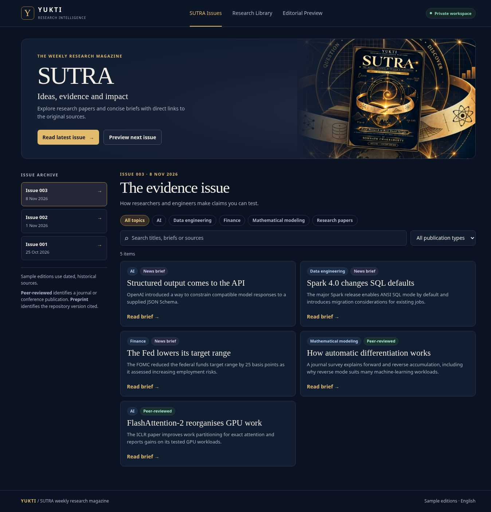
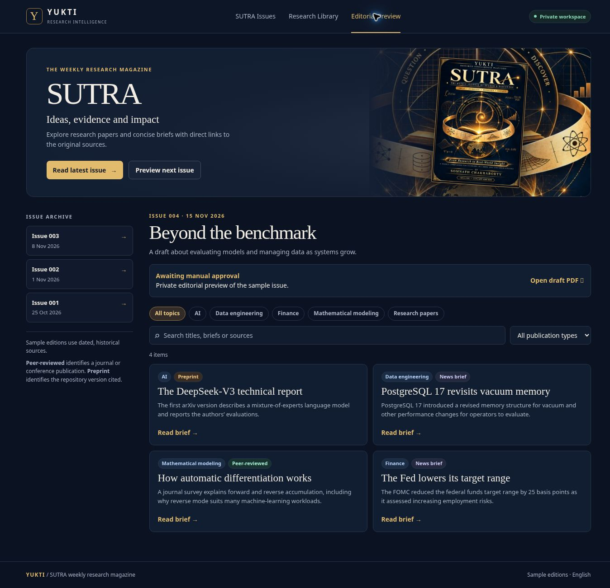
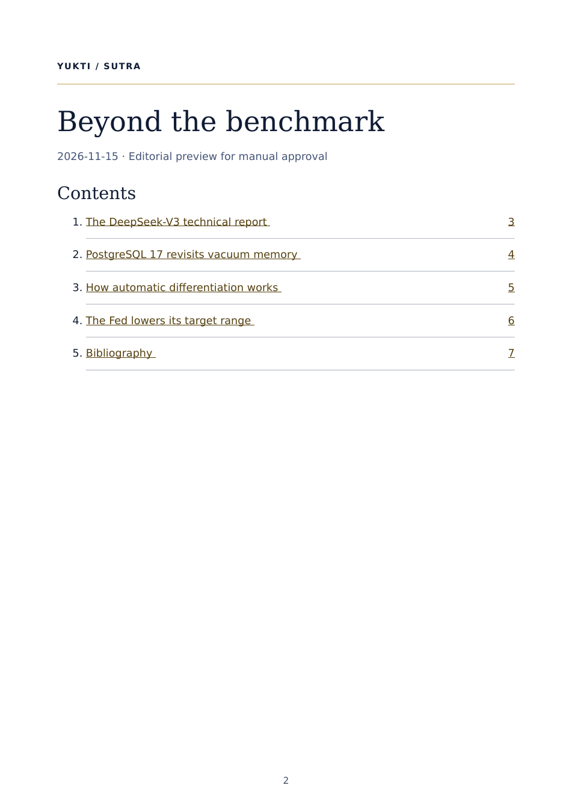
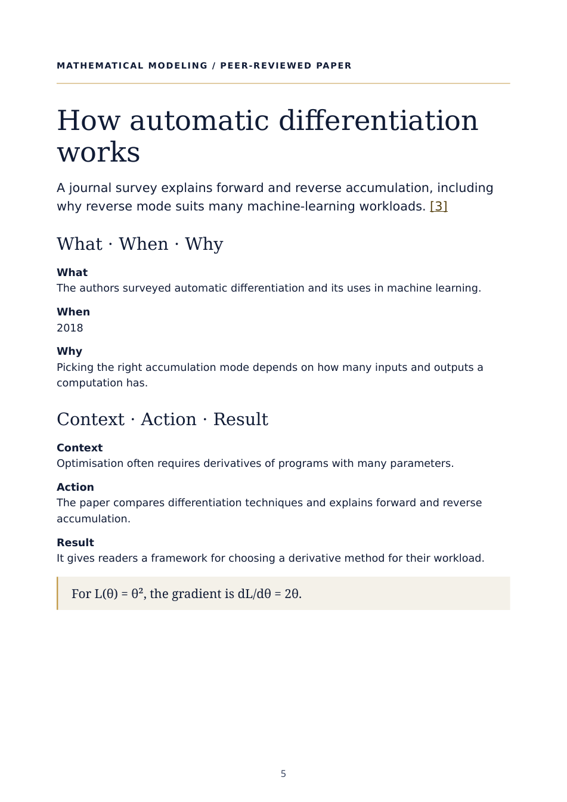
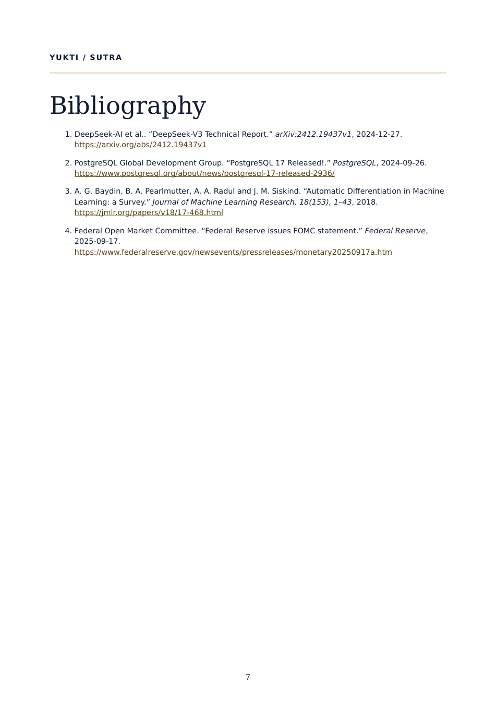

# YUKTI and SUTRA Project Walkthrough

YUKTI is the research intelligence platform. SUTRA is its weekly English research magazine. YUKTI collects evidence from configured primary sources, helps editors turn it into reviewed briefs, and produces a PDF issue for human approval. The magazine covers AI, data engineering, finance, mathematical modeling, and research papers.

## System architecture

| Part | Role | Repository location |
| --- | --- | --- |
| Local browser apps | Research dashboard, editorial console, and tenant magazine reader | [Application directories](../apps/) |
| FastAPI and Keycloak | Verify identity and roles, expose the APIs, and scope requests to the user's tenant | [API](../apps/api/) · [Identity adapter](../adapters/identity_provider/) |
| PostgreSQL and artifact storage | Store evidence, reviews, issue states, and audit events. Keep evidence snapshots and exact PDF bytes under checksums | [Database](../database/) · [Storage adapter](../adapters/object_storage/) |
| Airflow and the workers | Collect and validate evidence, prepare editorial queues, and render scheduled drafts | [DAGs](../workflows/airflow/dags/) · [Workers](../workers/) |
| LanguageTool and Ollama | Check grammar and spelling. Optionally generate editorial suggestions and embeddings | [Grammar adapter](../adapters/grammar_checker/) · [Ollama adapter](../adapters/ollama/) |
| Jinja2 and WeasyPrint | Apply the SUTRA cover and A4 layouts, produce the PDF, and run layout checks | [Templates](../templates/sutra/) · [PDF adapter](../adapters/pdf_renderer/) |

The browser screenshots below show the bundled static sample portal from [apps/web/public](../apps/web/public/). It reads [catalog.json](../apps/web/public/catalog.json) and opens the included draft PDF. The dashboard, console, and authenticated SUTRA reader use the local service stack shown in the diagram. PySpark and Iceberg support a separate bulk analytics path.

## From a source to a released issue

A brief uses **What · When · Why** to explain the finding and **Context · Action · Result** to summarize how it came about. It includes a direct primary-source reference and identifies the publication type, including whether a paper is peer-reviewed or a preprint. For example, SUTRA links a preprint to the cited arXiv version and a journal article to its publisher record.

When SUTRA creates an issue, it records the article revisions and the PDF checksum. An approver checks that checksum, then a separate publisher releases the exact PDF to the tenant archive. Airflow ends the scheduled flow at the draft.

| Job | Schedule in IST |
| --- | --- |
| Collect news | Daily at 05:00 |
| Collect research | Daily at 05:10 |
| Validate evidence | Daily at 05:25 |
| Prepare the editorial queue | Sunday at 05:45 |
| Generate the SUTRA draft | Sunday at 06:00 |

[Schedule configuration](../config/publishing/weekly-schedule.yaml) · [Editorial workflow](editorial/README.md) · [Publication rules](publishing/README.md)

## Browser views

### Issue archive and filters

The archive lists sample editions and lets readers search or filter briefs by topic and publication type. The badges identify a news brief, peer-reviewed paper, or preprint.

### Editorial preview

Issue 004, *Beyond the benchmark*, is marked **Awaiting manual approval** in the sample portal. **Open draft PDF** opens the bundled issue.

## SUTRA magazine PDF

[Open the seven-page A4 sample issue](../apps/web/public/assets/sutra-draft.pdf)

### Cover

### Linked contents

### Peer-reviewed research brief

### Bibliography

## Reproduce the demo

- Open the bundled PDF immediately from the link above.
- Follow the [repository setup](../README.md#start-locally) and open `http://localhost:8000/portal/` for the browser demo. Select **Editorial Preview** to open the magazine from the portal.
- With the locked local environment installed, run `make pdf` from the repository root. The command writes `var/sutra-draft.pdf` for review.

[Architecture details](architecture/README.md) · [Local operations](operations/README.md) · [Verification and remaining checks](../TEST_REPORT.md)
