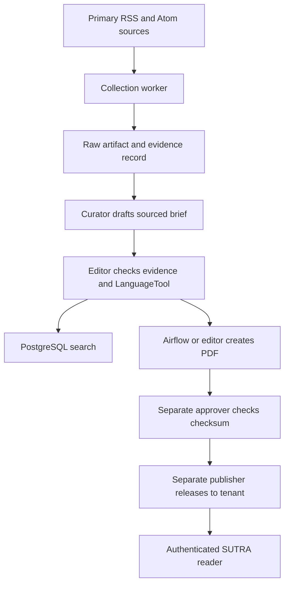

# Architecture

The FastAPI app hosts the local HTML clients. The static sample portal is independently deployable and carries a bundled catalog and PDF. Dashboard, console and local SUTRA reader use the same authenticated API. Packages own data contracts, validation and publishing policy. Adapters contain SQL, HTTP, object-store and rendering mechanics. The composition root lives in `packages/core/services.py`.

PostgreSQL is the local operational authority. File writes are content-addressed and atomic on a shared local volume. The database retains checksums and metadata. Spark reads bounded JSONL exports as a separate bulk path. The Iceberg adapter requires a configured catalog and runtime jar. S3-compatible storage is an alternative adapter and requires bucket write-once and retention policy outside this repository.

## Design decisions

- The local workflow has one editorial queue per tenant. A verified Keycloak token binds a request to one tenant. There is no user-selectable tenant parameter.
- Scheduling collects and validates source metadata and makes a draft from already reviewed entries. Human editing and approval remain independent.
- A checksum references immutable bytes. Releasing an issue changes access in the authenticated tenant archive and writes a transactional outbox record.
- SQLite is useful for dependency-light API tests. Its tenant scoping relies on application filters. PostgreSQL adds database-enforced row-level security.
- Ollama suggestions are advisory. The service never signs off a source, auto-approves a brief or publishes a magazine.

Evidence with invalid metadata is recorded in a tenant-scoped quarantine. Published issues remain pinned to reviewed article revisions and exact PDF bytes. The vector search and hybrid endpoint operate over reviewed revisions.
